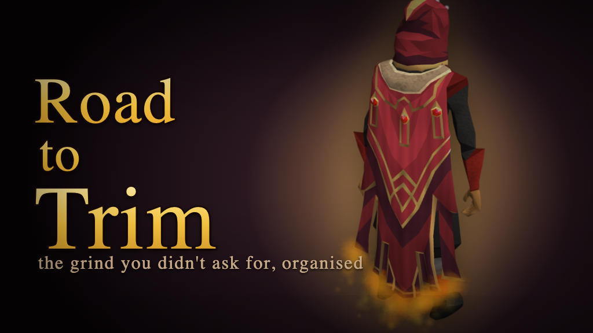

# Road to Trim

Your personal route to the Trimmed Completionist cape. Reads your account and tells you exactly what to do next.

## About

**Road to Trim** is a RuneScape plugin that turns the long grind toward the Trimmed Completionist cape into one clear, ordered to-do list. It reads your character's skills, quests, achievements, and inventory live from the game, then builds a guide that adapts to you: it always shows the next thing you should do, what is still blocking it, and what else you can get done right now in the meantime.

No more juggling spreadsheets and wiki tabs. The plugin tracks your progress, points you to training methods, quests, and items you still need, and even helps with travel (lodestones and teleports) so you spend less time planning and more time playing.

## Features

- **Adaptive route.** Merges the game's own Trimmed, Completionist, and Master Quest Cape checklists into a single ordered path that reshapes itself around what you have already done.
- **"What next" at a glance.** Shows your current step, what it needs (levels, quests, earlier steps, achievements, items), and a few things further down the list you can already do.
- **Training guidance.** Suggests a training method for any skill level you are short on.
- **Travel help.** Nearest lodestones and teleport spells for each step.
- **Alerts and follow-ups.** Flags time-gated activities and reminders so nothing slips.
- **Reads your account automatically.** Pulls live state from the game. Local preferences are saved per computer.

## Status

Version 1.1.0.
